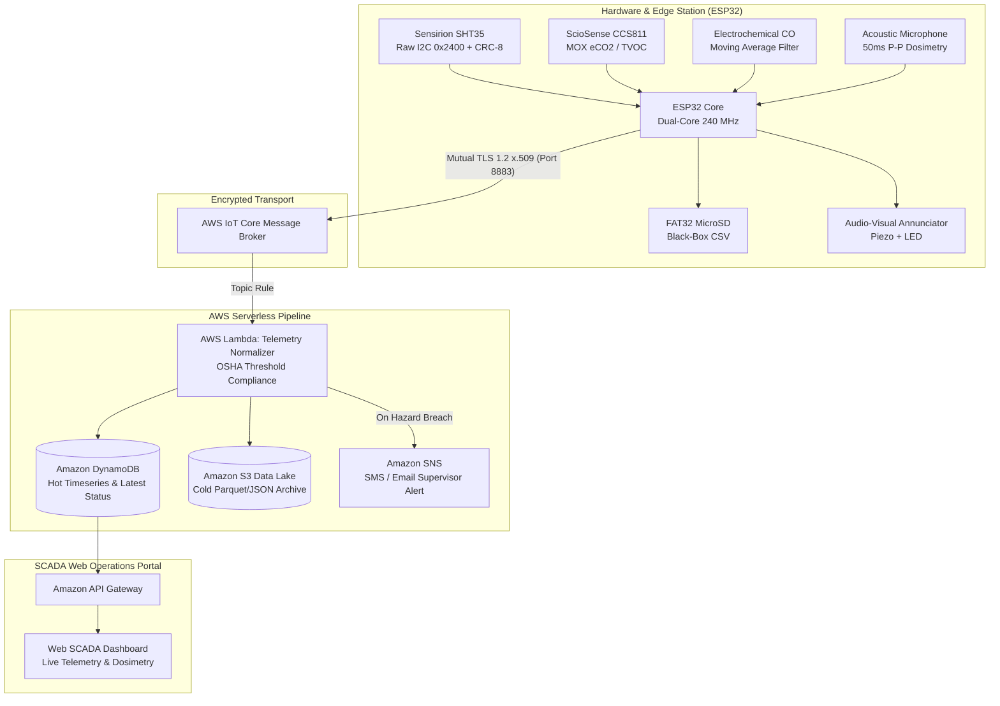

# Industrial Multi-Gas, Acoustic & Environmental Monitoring Station
### Edge-to-Cloud SCADA, AWS Serverless IoT Pipeline & Web Dashboard

<div align="center">

[](LICENSE)
[](https://www.espressif.com/)
[](#sensor-instrumentation--signal-processing)
[](cloud/ARCHITECTURE.md)
[](dashboard/)

</div>

> [!WARNING]
> **PROPRIETARY PORTFOLIO SHOWCASE NOTICE**  
> This repository is published strictly for technical evaluation, code review, and architectural demonstration as part of **Kadir Mercan's (Mercan Studio)** engineering portfolio.  
> **All rights reserved.** Reproduction, commercial deployment, redistribution, or derivation of this codebase without prior written authorization is strictly prohibited under the terms of the included [LICENSE](LICENSE).

---

## 🎯 Executive Summary

An industrial-grade, edge-to-cloud environmental and occupational safety monitoring platform powered by the **Espressif ESP32 SoC**. Engineered for harsh industrial plant environments, the firmware simultaneously samples precision microclimate conditions, air toxicity, combustible/asphyxiating gases, and acoustic noise pollution. 

Telemetry is timestamped via **SNTP UTC**, logged locally to an onboard **MicroSD SPI black-box** in FAT32 CSV format, and streamed over **Mutual TLS (mTLS 1.2)** to an **AWS Serverless Cloud Pipeline** (IoT Core → Lambda → DynamoDB & S3 Cold Storage) feeding a live **SCADA Operations Dashboard**.

---

## 🏛️ End-to-End System Architecture



---

## 💻 Interactive Web SCADA Dashboard (`dashboard/`)

The repository includes a production-grade, dark-themed **Industrial SCADA Web Dashboard** located in `dashboard/index.html`. It runs out-of-the-box in modern browsers with:
- **Live Multi-Gas Concentration Dynamics (Chart.js):** Real-time rolling time-series for Toxic Carbon Monoxide (ppm), Air Quality eCO₂ (ppm), and Total VOCs (ppb).
- **Acoustic Dosimetry vs OSHA 85 dBA Action Limit:** Real-time sound pressure monitoring with occupational exposure indicators.
- **Dual Connectivity Modes:**
  1. **Industrial Hardware Emulator:** Simulates real-time plant telemetry with an interactive **"Inject Gas Spike Test"** button to evaluate hazard annunciators and alarm states.
  2. **Live AWS IoT / API Gateway Integration:** Directly polls your Amazon API Gateway or WebSocket endpoints.
- **Real-Time Event Stream:** Log of incoming telemetry and compliance alerts.

👉 **Launch Dashboard:** Open `dashboard/index.html` in your web browser.

---

## 🔬 Sensor Instrumentation & Signal Processing

| Metric | Sensor Component | Interface | Signal Processing & Calibration |
|:---|:---|:---:|:---|
| **Temperature & Humidity** | **Sensirion SHT35** | Raw I2C (`0x44`) | `0x2400` high-repeatability command + hardware CRC-8 verification polynomial ($x^8 + x^5 + x^4 + 1$) |
| **eCO2 & TVOC** | **ScioSense CCS811** | I2C (`0x5A`) | Metal-oxide (MOX) gas sensor with automatic baseline compensation |
| **Carbon Monoxide (CO)** | **Electrochemical MQ** | 12-bit ADC (`GPIO 32`) | Discrete circular moving average filter ($N=5$) + clean-air baseline voltage offset calibration |
| **Acoustic Noise (dBA)** | **Electret Mic Subsystem** | 12-bit ADC (`GPIO 34`) | High-speed 50 ms peak-to-peak amplitude windowing with logarithmic sound pressure conversion |

---

## ☁️ AWS Serverless Cloud Architecture (`cloud/`)

Full serverless infrastructure blueprints are documented in [`cloud/ARCHITECTURE.md`](cloud/ARCHITECTURE.md):
- **`cloud/lambda/telemetry_normalizer.py`:** Python 3.11 AWS Lambda function validating incoming MQTT payloads, checking OSHA/EU-OSHA exposure limits, archiving to S3, and persisting to DynamoDB.
- **`cloud/dynamodb_schema.json`:** Provisioning schema for partitioned time-series (`IndustrialEnv_Telemetry`) and instant status lookups (`IndustrialEnv_StationLatest`).
- **Amazon S3 Data Lake:** Auto-partitioned cold storage (`year=YYYY/month=MM/day=DD/`) for long-term industrial compliance reporting.

---

## 📊 Offline Black-Box Datalogging

To ensure occupational health compliance even during total network outages, all metrics are recorded to an industrial MicroSD card:
```csv
Timestamp,Date,Time,Temperature_C,Humidity_RH,eCO2_ppm,TVOC_ppb,CO_ppm,Noise_dBA,Status
1718000000,2026-09-27,08:30:00,24.3,48.2,680,95,2.10,64.5,NOMINAL
1718000002,2026-09-27,08:30:02,24.4,48.1,685,96,2.15,65.0,NOMINAL
```

---

## 🛠️ Build & Deployment

### Hardware Firmware (PlatformIO)
```bash
# Clone and open directory
cd industrial-env-monitor

# Compile ESP32 firmware
pio run -e esp32dev

# Flash to target board via USB-UART
pio run -e esp32dev --target upload
```

### Web SCADA Dashboard
Simply open `dashboard/index.html` in any modern web browser or serve it with any static server:
```bash
cd dashboard
python -m http.server 8080
# Navigate to http://localhost:8080
```
