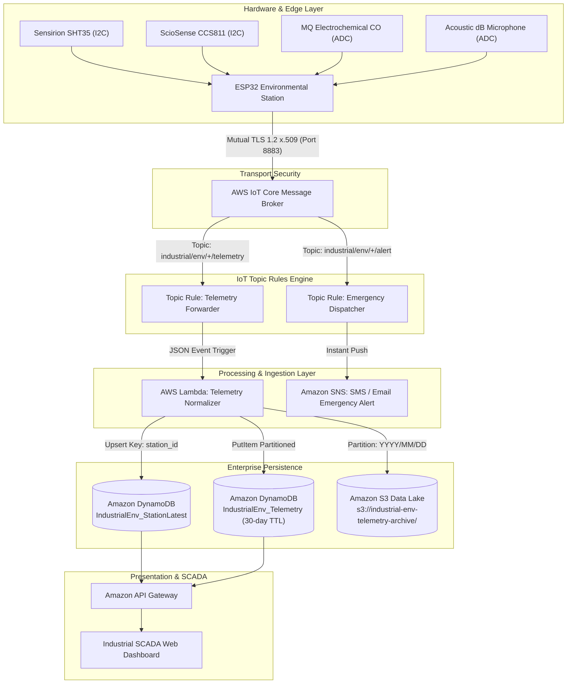

# Cloud Architecture: Enterprise Serverless Telemetry Pipeline

This document details the **AWS Serverless IoT Ingestion Pipeline** supporting the **Industrial Multi-Gas & Environmental Monitoring Station**.

---

## 🏛️ System Architecture Diagram



---

## 1. AWS IoT Core Ingestion & Topic Structure

### Topic Hierarchy
The device publishes to structured hierarchical topics:
- **Telemetry Stream (5s interval):**  
  `industrial/env/{facility_id}/{station_id}/telemetry`
- **Critical Safety Alarms (Immediate):**  
  `industrial/env/{facility_id}/{station_id}/alert`
- **Device Lifecycle Status (LWT / Keep-alive):**  
  `industrial/env/{facility_id}/{station_id}/status`

### AWS IoT Topic Rule SQL
```sql
SELECT 
    topic(3) AS facility_id,
    topic(4) AS station_id,
    timestamp,
    uptime_sec,
    metrics,
    status
FROM 'industrial/env/+/+/telemetry'
```

---

## 2. Serverless Normalization & Compliance (AWS Lambda)

The telemetry normalizer (`cloud/lambda/telemetry_normalizer.py`) runs in Python 3.11 with the following responsibilities:
1. **OSHA/EU-OSHA Threshold Evaluation:** Compares raw concentrations against toxic thresholds:
   - **CO Limit:** 50 ppm (Critical Danger), 25 ppm (Warning)
   - **Sound Level:** 85 dBA (OSHA Action Level), 90 dBA (Mandatory Hearing Defense)
   - **eCO2:** 2500 ppm (Ventilation Deficit)
2. **Cold Storage Archiving (Amazon S3):**  
   Stores raw telemetry under partitioned keys:  
   `s3://industrial-env-telemetry-archive/raw/facility={facility}/station={station}/year={YYYY}/month={MM}/day={DD}/{station}_{timestamp}.json`
3. **Hot Cache Persistence (Amazon DynamoDB):**  
   - `IndustrialEnv_Telemetry`: Partition Key: `station_id` (String), Sort Key: `timestamp` (Number), TTL: `ttl_expire` (30 days automatic expiration).
   - `IndustrialEnv_StationLatest`: Key: `station_id` (Instant single-item lookup for dashboard headers).

---

## 3. High-Priority Safety Alarms (Amazon SNS)

When a sensor reading violates maximum permissible safety exposure limits, AWS Lambda immediately dispatches an emergency notification to the plant supervisor on-duty via **Amazon SNS**:
- **SMS alert** to plant emergency response teams.
- **Email report** with instant sensor readings, timestamp, and recommended evacuation or ventilation protocols.
